# Entity-Relationship (ER) Diagram & Relational Schema Architecture

**Course:** VIT, BCSE307L Database Systems (Fall 2026-27)  
**System:** AssetVault (Multi-Tenant Digital Asset & License Management System)  
**Database Engine:** PostgreSQL 16  

---

## 1. Entity-Relationship Diagram (Mermaid)

```mermaid
erDiagram
    TENANTS ||--o{ USERS : "employs / scopes"
    TENANTS ||--o{ VENDORS : "contracts"
    TENANTS ||--o{ CATEGORIES : "defines"
    TENANTS ||--o{ TAGS : "creates"
    TENANTS ||--o{ ASSETS : "owns"
    TENANTS ||--o{ LICENSES : "procures"
    TENANTS ||--o{ AUDIT_LOGS : "logs"
    TENANTS ||--o{ NOTIFICATIONS : "delivers"

    ROLES ||--o{ USERS : "assigned_to"

    USERS ||--o{ REFRESH_TOKENS : "issues"
    USERS ||--o{ ASSETS : "creates"
    USERS ||--o{ LICENSE_ALLOCATIONS : "receives_seat"
    USERS ||--o{ ASSET_ACCESS_LOGS : "performs_action"
    USERS ||--o{ AUDIT_LOGS : "triggers_mutation"
    USERS ||--o{ NOTIFICATIONS : "receives"

    CATEGORIES ||--o{ CATEGORIES : "sub_category_of"
    CATEGORIES ||--o{ ASSETS : "classifies"

    VENDORS ||--o{ LICENSES : "supplies"

    ASSETS ||--o{ ASSET_TAGS : "tagged_with"
    TAGS ||--o{ ASSET_TAGS : "applied_to"

    ASSETS ||--o{ ASSET_LICENSES : "covered_by"
    LICENSES ||--o{ ASSET_LICENSES : "protects"

    LICENSES ||--o{ LICENSE_ALLOCATIONS : "allocates_seats"

    ASSETS ||--o{ ASSET_ACCESS_LOGS : "access_recorded_in"

    TENANTS {
        uuid id PK "gen_random_uuid()"
        varchar name "NOT NULL"
        varchar slug "NOT NULL UNIQUE"
        varchar status "CHECK: active, suspended, trial"
        varchar subscription_tier "CHECK: free, standard, enterprise"
        timestamptz created_at "DEFAULT now()"
        timestamptz updated_at "DEFAULT now()"
    }

    ROLES {
        serial id PK "SERIAL lookup"
        varchar name "NOT NULL UNIQUE"
        text description
        timestamptz created_at "DEFAULT now()"
    }

    USERS {
        uuid id PK "gen_random_uuid()"
        uuid tenant_id FK "REFERENCES tenants(id) ON DELETE CASCADE"
        int role_id FK "REFERENCES roles(id)"
        varchar email "NOT NULL"
        varchar password_hash "Nullable for OAuth"
        varchar full_name "NOT NULL"
        text avatar_url
        varchar google_id "UNIQUE"
        boolean is_active "DEFAULT true"
        timestamptz created_at "DEFAULT now()"
        timestamptz updated_at "DEFAULT now()"
    }

    REFRESH_TOKENS {
        uuid id PK "gen_random_uuid()"
        uuid user_id FK "REFERENCES users(id) ON DELETE CASCADE"
        varchar token_hash "SHA-256 hash NOT NULL"
        timestamptz expires_at "NOT NULL"
        timestamptz revoked_at
        varchar ip_address
        text user_agent
        timestamptz created_at "DEFAULT now()"
    }

    VENDORS {
        uuid id PK "gen_random_uuid()"
        uuid tenant_id FK "REFERENCES tenants(id) ON DELETE CASCADE"
        varchar name "NOT NULL"
        varchar contact_email
        varchar contact_phone
        text website_url
        text address
        timestamptz created_at "DEFAULT now()"
        timestamptz updated_at "DEFAULT now()"
    }

    CATEGORIES {
        uuid id PK "gen_random_uuid()"
        uuid tenant_id FK "REFERENCES tenants(id) ON DELETE CASCADE"
        varchar name "NOT NULL"
        text description
        uuid parent_category_id FK "REFERENCES categories(id)"
        timestamptz created_at "DEFAULT now()"
        timestamptz updated_at "DEFAULT now()"
    }

    TAGS {
        uuid id PK "gen_random_uuid()"
        uuid tenant_id FK "REFERENCES tenants(id) ON DELETE CASCADE"
        varchar name "NOT NULL"
        varchar color_hex "DEFAULT #6B7280"
        timestamptz created_at "DEFAULT now()"
    }

    ASSETS {
        uuid id PK "gen_random_uuid()"
        uuid tenant_id FK "REFERENCES tenants(id) ON DELETE CASCADE"
        uuid category_id FK "REFERENCES categories(id)"
        varchar name "NOT NULL"
        varchar asset_type "CHECK: font, image, software, dataset, video, document, other"
        text description
        text file_url
        bigint file_size_bytes
        varchar mime_type
        varchar version "DEFAULT 1.0.0"
        jsonb metadata "DEFAULT {}"
        timestamptz deleted_at "Soft delete"
        uuid created_by_user_id FK "REFERENCES users(id) ON DELETE SET NULL"
        timestamptz created_at "DEFAULT now()"
        timestamptz updated_at "DEFAULT now()"
    }

    ASSET_TAGS {
        uuid id PK "gen_random_uuid()"
        uuid asset_id FK "REFERENCES assets(id) ON DELETE CASCADE"
        uuid tag_id FK "REFERENCES tags(id) ON DELETE CASCADE"
        timestamptz created_at "DEFAULT now()"
    }

    LICENSES {
        uuid id PK "gen_random_uuid()"
        uuid tenant_id FK "REFERENCES tenants(id) ON DELETE CASCADE"
        uuid vendor_id FK "REFERENCES vendors(id) ON DELETE RESTRICT"
        varchar name "NOT NULL"
        text license_key
        varchar license_type "CHECK: per_seat, site, subscription, perpetual, open_source"
        int total_seats "CHECK: total_seats >= 0"
        numeric cost "numeric(12,2) CHECK: cost >= 0"
        varchar currency "DEFAULT USD"
        timestamptz starts_at "NOT NULL"
        timestamptz expires_at
        boolean is_auto_renew "DEFAULT false"
        int renewal_reminder_days "DEFAULT 30"
        varchar status "CHECK: active, expired, suspended, pending_renewal"
        timestamptz deleted_at "Soft delete"
        timestamptz created_at "DEFAULT now()"
        timestamptz updated_at "DEFAULT now()"
    }

    ASSET_LICENSES {
        uuid id PK "gen_random_uuid()"
        uuid asset_id FK "REFERENCES assets(id) ON DELETE CASCADE"
        uuid license_id FK "REFERENCES licenses(id) ON DELETE CASCADE"
        text notes
        timestamptz created_at "DEFAULT now()"
    }

    LICENSE_ALLOCATIONS {
        uuid id PK "gen_random_uuid()"
        uuid license_id FK "REFERENCES licenses(id) ON DELETE CASCADE"
        uuid user_id FK "REFERENCES users(id) ON DELETE CASCADE"
        timestamptz allocated_at "DEFAULT now()"
        timestamptz revoked_at
        text notes
    }

    ASSET_ACCESS_LOGS {
        uuid id PK "gen_random_uuid()"
        uuid asset_id FK "REFERENCES assets(id) ON DELETE CASCADE"
        uuid user_id FK "REFERENCES users(id) ON DELETE SET NULL"
        varchar action "CHECK: view, download, checkout, checkin"
        varchar ip_address
        text user_agent
        timestamptz created_at "DEFAULT now()"
    }

    AUDIT_LOGS {
        uuid id PK "gen_random_uuid()"
        uuid tenant_id FK "REFERENCES tenants(id) ON DELETE CASCADE"
        uuid user_id FK "REFERENCES users(id) ON DELETE SET NULL"
        varchar entity_type "NOT NULL"
        uuid entity_id "NOT NULL"
        varchar action "CHECK: CREATE, UPDATE, DELETE, ALLOCATE, REVOKE, LOGIN, LOGOUT"
        jsonb old_values
        jsonb new_values
        varchar ip_address
        timestamptz created_at "DEFAULT now()"
    }

    NOTIFICATIONS {
        uuid id PK "gen_random_uuid()"
        uuid tenant_id FK "REFERENCES tenants(id) ON DELETE CASCADE"
        uuid user_id FK "REFERENCES users(id) ON DELETE CASCADE"
        varchar title "NOT NULL"
        text message "NOT NULL"
        varchar type "CHECK: license_expiry, renewal_due, seat_exhaustion, system"
        boolean is_read "DEFAULT false"
        timestamptz read_at
        timestamptz created_at "DEFAULT now()"
    }
```

---

## 2. Cardinality & Relationship Breakdown

| Primary Entity | Foreign Entity | Cardinality | Business Meaning & Constraint Rationale |
| :--- | :--- | :---: | :--- |
| `tenants` | `users` | 1 : N | An organization employs multiple users. Enforces tenant scope. `ON DELETE CASCADE`. |
| `tenants` | `vendors` | 1 : N | A tenant manages multiple vendors with whom they hold commercial accounts. |
| `tenants` | `categories` | 1 : N | Categorization taxonomy is tenant-customizable. |
| `tenants` | `tags` | 1 : N | Tagging vocabulary is tenant-customizable. |
| `tenants` | `assets` | 1 : N | All digital assets belong directly to a tenant organization. |
| `tenants` | `licenses` | 1 : N | Software and digital licenses are purchased and owned by the tenant. |
| `tenants` | `audit_logs` | 1 : N | Immutable compliance logs scoped to the tenant organization. |
| `tenants` | `notifications` | 1 : N | Operational alerts delivered within tenant boundaries. |
| `roles` | `users` | 1 : N | Fixed RBAC roles (`super_admin`, `tenant_admin`, `asset_manager`, `member`, `auditor`). |
| `users` | `refresh_tokens`| 1 : N | A user can have active sessions across multiple devices. SHA-256 tokens. |
| `users` | `assets` | 1 : N | Tracks original uploader/author of an asset via `created_by_user_id`. |
| `vendors` | `licenses` | 1 : N | A software vendor issues multiple software/seat licenses. `ON DELETE RESTRICT`. |
| `categories` | `categories` | 1 : N | Self-referencing hierarchical taxonomy (e.g., "Fonts" -> "Serif Fonts"). |
| `categories` | `assets` | 1 : N | An asset belongs to exactly one category for clear organization. |
| `assets` | `tags` | M : N | Implemented via `asset_tags` join table. |
| `assets` | `licenses` | M : N | Implemented via `asset_licenses` join table (e.g., font family covered by multiple licenses). |
| `licenses` | `users` | M : N | Seat allocations tracked in `license_allocations`. Partial unique index on active seats. |
| `assets` | `asset_access_logs` | 1 : N | Every view or download creates an immutable access log. |

---

## 3. Strict 3NF Tenancy Inheritance Architecture

In accordance with database design Rule 3 and Rule 6:
* **Top-Level Tenant Tables** (`users`, `vendors`, `categories`, `assets`, `tags`, `licenses`, `audit_logs`, `notifications`) include an explicit `tenant_id` foreign key.
* **Child Tables** (`refresh_tokens`, `asset_tags`, `asset_licenses`, `license_allocations`, `asset_access_logs`) **DO NOT** duplicate `tenant_id`. 
  - `refresh_tokens` inherits tenancy through `user_id -> users.tenant_id`.
  - `asset_tags` inherits tenancy through `asset_id -> assets.tenant_id`.
  - `asset_licenses` inherits tenancy through `license_id -> licenses.tenant_id`.
  - `license_allocations` inherits tenancy through `license_id -> licenses.tenant_id`.
  - `asset_access_logs` inherits tenancy through `asset_id -> assets.tenant_id`.

Duplicating `tenant_id` into these child tables would introduce **transitive dependencies** (`license_allocations.id -> license_id -> tenant_id` AND `license_allocations.id -> tenant_id`), violating Third Normal Form (3NF) and opening the possibility of update anomalies (where a child record might incorrectly point to Tenant B while its parent points to Tenant A).
