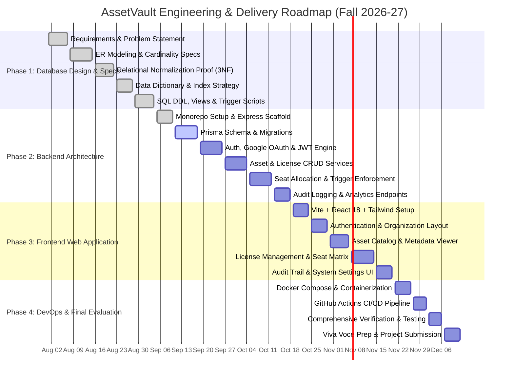

# AssetVault: Project Schedule & Gantt Chart

**Course:** BCSE307L Database Systems (Fall 2026-27)  
**Project:** AssetVault (Multi-Tenant Digital Asset & License Management System)  

---

## 1. Development Timeline (Mermaid Gantt Chart)

---

## 2. Work Breakdown Structure (WBS)

| Sprint / Phase | Focus Area | Deliverables | Status |
| :---: | :--- | :--- | :---: |
| **Sprint 1** | Conceptual & Logical DB Design | ER Diagram, Functional Dependency analysis, 3NF mathematical proofs. | Completed |
| **Sprint 2** | Physical DB Design & SQL Programming | DDL schemas, PL/pgSQL triggers, views, RLS policies, indexing scripts. | Completed |
| **Sprint 3** | Backend Foundations & Security | Express app, Zod environment validation, BCrypt, JWT rotation, Google OAuth. | In Progress |
| **Sprint 4** | Core Business Domains | Asset catalog endpoints, License allocation engine, Audit trail capture. | Upcoming |
| **Sprint 5** | Frontend User Experience | Responsive React 18 UI, TanStack Query caching, seat matrix UI. | Upcoming |
| **Sprint 6** | DevOps & Final Review | Multi-container Docker Compose, GitHub Actions CI, Viva notes. | Upcoming |
